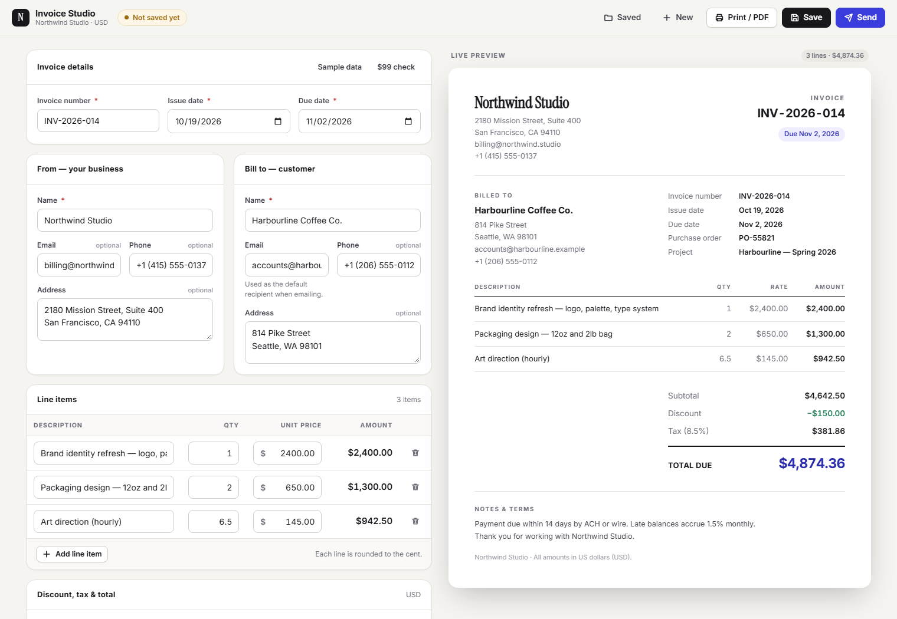

# Invoice Studio

A customizable invoice generator for a small business: a live editor with a
document-quality preview, USD totals that are correct to the cent, custom
fields you can show or hide, print-to-PDF that prints only the invoice,
persistence in MySQL/MariaDB, and invoice delivery over SMTP.



**Stack:** React 18 + Vite · Express 4 (Node 20+) · MySQL 8 / MariaDB 10.4+ ·
nodemailer (generic SMTP). No CSS framework, no ORM, no UI library.

---

## Contents

- [Quick start](#quick-start)
- [Configuration](#configuration)
- [How the money math works](#how-the-money-math-works)
- [Architecture](#architecture)
- [API](#api)
- [Database schema](#database-schema)
- [Email](#email)
- [Print / PDF](#print--pdf)
- [Accessibility](#accessibility)
- [Tests](#tests)
- [Decisions and trade-offs](#decisions-and-trade-offs)
- [AI tools used](#ai-tools-used)
- [Time spent](#time-spent)
- [What is not finished](#what-is-not-finished)

---

## Quick start

**Prerequisites:** Node 20 or newer, and a running MySQL 8 or MariaDB 10.4+.

```bash
git clone <this-repo>
cd invoice
npm install                 # installs all three workspaces

cp .env.example server/.env # then edit server/.env (see below)
npm run db:init             # creates the database and tables
npm run dev                 # API on :4000, app on http://localhost:5173
```

Open <http://localhost:5173>. The editor loads with sample data from a
fictional studio so the first screen looks like a finished invoice.

Other scripts:

| Command | What it does |
| --- | --- |
| `npm run dev` | Express (`:4000`) and Vite (`:5173`) together; Vite proxies `/api` |
| `npm run build` | Builds the client into `client/dist` |
| `npm start` | Production: one Node process serving the API **and** `client/dist` |
| `npm run db:init` | Creates the database + schema, verifies credentials |
| `npm test` | Runs the money/totals/validation test suite |

### Production

```bash
npm run build
NODE_ENV=production npm start   # serves API + built client on PORT (default 4000)
```

When `client/dist` exists, the Express process serves it and falls back to
`index.html` for client-side routes, so the whole app deploys as a single Node
service.

### Deploying behind Apache with PM2

The repo ships two deployment files:

- [`ecosystem.config.cjs`](ecosystem.config.cjs) — PM2 process definition. It
  carries `NODE_ENV` and `PORT` only; **secrets stay in `server/.env`**, which
  the app reads itself, so this file is safe to commit.
- [`deploy/invoice.nextolive.com.conf`](deploy/invoice.nextolive.com.conf) —
  an Apache vhost that reverse-proxies one port to the single Node process.

On a shared box running other sites, the whole procedure is additive — a new
directory, a new database, a new PM2 app on an unused port, and one new vhost
file. Nothing existing is edited.

```bash
sudo mkdir -p /var/www/invoice.example.com && cd /var/www/invoice.example.com
# upload the repo WITHOUT node_modules/, client/dist/ or server/.env

npm install && npm run build
nano server/.env && chmod 600 server/.env   # see Configuration above
npm run db:init
npm run smtp:probe --workspace server       # confirm SMTP before going live

pm2 start ecosystem.config.cjs && pm2 save

sudo cp deploy/invoice.nextolive.com.conf /etc/apache2/sites-available/
sudo a2ensite invoice.nextolive.com
sudo apachectl configtest   # gate: never reload on a failed configtest
sudo systemctl reload apache2

sudo certbot --apache -d invoice.example.com
# then flip X-Forwarded-Proto to "https" in the generated -le-ssl.conf
```

Requires `proxy`, `proxy_http` and `headers` to be enabled (`a2enmod`). Two
things that reliably bite:

- **Point DNS at the box before running certbot.** HTTP-01 validation hits the
  A record, so a subdomain still pointing at an old host fails with a confusing
  authorization error.
- **`apachectl configtest` before every reload.** A failed test means Apache is
  never reloaded, so a typo in the new vhost cannot take the other sites down.

Rollback is `a2dissite <site> && systemctl reload apache2 && pm2 delete
invoice-studio` — no existing file was changed, so there is nothing to restore.

---

## Configuration

Everything is configured through environment variables. Copy
[`.env.example`](.env.example) to `server/.env` (a root-level `.env` also
works) and fill it in. **No secret is ever read by the browser** — the client
bundle contains no keys, no DSN and no API base URL.

```ini
PORT=4000
CORS_ORIGIN=http://localhost:5173

DB_HOST=127.0.0.1
DB_PORT=3306            # WAMP/MariaDB is often 3307
DB_USER=invoice_app
DB_PASSWORD=…
DB_NAME=invoice_studio

SMTP_HOST=smtp.example.com
SMTP_PORT=587
SMTP_SECURE=false       # true for port 465 (implicit TLS)
SMTP_USER=…
SMTP_PASSWORD=…
MAIL_FROM_NAME=Northwind Studio Billing
MAIL_FROM_EMAIL=billing@example.com
MAIL_BCC=
MAIL_USE_ETHEREAL_FALLBACK=true
```

### Database setup

`npm run db:init` creates the database and both tables if they do not exist
(the server also does this on boot), so the only manual step is making a user:

```sql
CREATE DATABASE IF NOT EXISTS invoice_studio
  CHARACTER SET utf8mb4 COLLATE utf8mb4_unicode_ci;
CREATE USER 'invoice_app'@'localhost' IDENTIFIED BY 'a-strong-password';
GRANT ALL PRIVILEGES ON invoice_studio.* TO 'invoice_app'@'localhost';
FLUSH PRIVILEGES;
```

If the database is unreachable the server says so loudly and exits non-zero
rather than starting up and looking healthy.

### Email setup

Any SMTP provider works — Brevo, Mailgun, Postmark, Resend's SMTP bridge,
Mailtrap, a Gmail app password, or your own mail server. Set the five `SMTP_*`
values and restart the API; there is no provider-specific code to change.

With `SMTP_HOST` empty and `MAIL_USE_ETHEREAL_FALLBACK=true`, the server
creates a throwaway [Ethereal](https://ethereal.email) mailbox and returns a
preview URL instead of delivering. That makes a fresh clone runnable with no
credentials, and the UI labels it clearly as a test transport so it can't be
mistaken for a real send.

---

## How the money math works

This is the part most likely to be subtly wrong, so it is centralised in one
module ([`shared/src/totals.js`](shared/src/totals.js)) that both the browser
and the server import — there is no second implementation to drift.

**Money is never stored in a float.** Amounts are integer cents, quantities are
integer thousandths, and tax rates are integer thousandths of a percent.
Parsing works on the digit string rather than `parseFloat(x) * 100`, so
`"1.005"` rounds deterministically to `101` cents instead of inheriting binary
floating-point error.

The order of operations is fixed:

1. **line amount** = `round_half_up(quantity × unit price)` — rounded per line
2. **subtotal** = sum of the **already rounded** line amounts
3. **discount** = `min(fixed discount, subtotal)` — the total can't go negative
4. **taxable base** = subtotal − discount
5. **tax** = `round_half_up(taxable base × rate)` — rounded once, at the end
6. **grand total** = taxable base + tax

The brief's acceptance case, `2 × $50 − $10 discount + 10% tax`:

| Step | Integer math | Value |
| --- | --- | --- |
| Line | `round(2000 × 5000 / 1000)` | `10000c` = $100.00 |
| Subtotal | — | `10000c` = $100.00 |
| Discount | `min(1000, 10000)` | `1000c` = $10.00 |
| Taxable | `10000 − 1000` | `9000c` = $90.00 |
| Tax | `round(9000 × 10000 / 100000)` | `900c` = $9.00 |
| **Total** | `9000 + 900` | **`9900c` = $99.00** |

This case is pinned by two tests (direct, and through the full draft →
normalise path) and by an end-to-end API check. The UI also has a **$99 check**
button in the *Invoice details* card that loads exactly this invoice.

### Validation

The same validator runs on every keystroke in the browser *and* on every write
in the API, so the server is the authority and a hand-crafted `curl` cannot
store bad data. Failures come back as `422` with a `{ fieldPath: message }` map
that the editor renders as inline errors.

Rejected: negative quantities, negative unit prices, negative discounts,
negative tax rates, tax rates above 100%, a discount greater than the subtotal,
an invoice with no line items, missing invoice number / business name /
customer name, malformed or calendar-invalid dates, and a due date earlier than
the issue date. Numeric inputs additionally swallow the `-` key and carry
`min="0"`, so a negative is awkward to even type — but the browser is
convenience, not the guard.

---

## Architecture

```
invoice/
├── shared/          @invoice/shared — imported by BOTH client and server
│   └── src/
│       ├── money.js      integer parsing/formatting, no floats
│       ├── totals.js     the calculation, defined once
│       ├── validate.js   draft → canonical invoice + error map
│       ├── sample.js     seed data and draft factories
│       └── totals.test.js
├── server/          Express API
│   └── src/
│       ├── config.js         env loading (the only place secrets live)
│       ├── db.js             pool + schema creation
│       ├── repository.js     SQL, row ↔ invoice mapping
│       ├── mailer.js         nodemailer SMTP transport
│       ├── email-template.js table-based HTML email + plain-text part
│       ├── routes.js         the API surface
│       └── index.js          boot, static client, error handling
└── client/          React + Vite
    └── src/
        ├── App.jsx           state, persistence, autosave, orchestration
        ├── lib/              API client, draft ↔ invoice conversion
        ├── components/       editor sections, invoice sheet, overlays
        └── styles.css        the design system
```

A three-package npm workspace exists for one reason: `@invoice/shared` is a
real dependency of both sides, so the calculation and the validation rules are
physically impossible to duplicate.

**State model.** `draft` is the only source of truth in the editor and holds
numeric fields as *strings* (so `""`, `"1."` and a mid-edit caret all behave).
Every render pipes it through `normalizeInvoice`, which returns the canonical
invoice, the totals and the error map. The preview, the totals panel and the
inline errors all read from that single result — which is why the preview can
never disagree with the numbers.

**Persistence.** MySQL is the system of record. The first **Save** `POST`s and
receives a UUID; after that, valid edits autosave on a 1.4 s debounce. The id
is kept in `localStorage` purely as a bookmark, so on reload the app re-fetches
from `GET /api/invoices/:id` — what you see after F5 came out of the database.
A never-yet-saved draft is also mirrored to `localStorage` so a refresh before
the first save isn't destructive.

---

## API

| Method | Path | Notes |
| --- | --- | --- |
| `GET` | `/api/health` | service + which mail transport is live |
| `GET` | `/api/invoices` | recent invoices for the drawer |
| `POST` | `/api/invoices` | create → `201` with the stored invoice + totals |
| `GET` | `/api/invoices/:id` | fetch one — this is what survives a reload |
| `PUT` | `/api/invoices/:id` | update |
| `DELETE` | `/api/invoices/:id` | `204` |
| `POST` | `/api/invoices/:id/email` | render server-side and send via SMTP |
| `GET` | `/api/invoices/:id/emails` | delivery log for that invoice |

Totals are **never** taken from the request body — the server recomputes them
from the normalised line items and stores its own numbers. Ids must be UUIDs,
so malformed ids 404 instead of reaching SQL. The email endpoint is rate
limited to 12 sends/minute per IP.

---

## Database schema

Two tables, created automatically. A deliberate hybrid: anything worth
filtering or sorting gets a real typed column; the repeating structures are
JSON documents because they are only ever read as part of a whole invoice.

- **`invoices`** — ids, dates, both parties, `line_items` / `custom_fields` as
  JSON, notes, and `discount_cents` / `tax_rate_milli` / `subtotal_cents` /
  `tax_cents` / `total_cents` as `BIGINT UNSIGNED`. There is no `DECIMAL` and
  no `FLOAT` in the schema; `UNSIGNED` means a negative amount cannot be
  stored even if every other guard failed.
- **`invoice_emails`** — one row per send attempt (`sent` / `failed`),
  recipient, subject, transport, provider message id, preview URL and error,
  with an `ON DELETE CASCADE` back to the invoice.

---

## Email

Pressing **Send** saves first (if needed), then calls the API with an invoice
id, an optional recipient override and an optional note. The server reads the
invoice **back out of the database**, renders the email itself and sends it —
the request body cannot influence the contents of what goes out.

The email is a table-based, inline-styled HTML document (so it survives Outlook
and Gmail) with a real `text/plain` alternative generated from the same data.
Every interpolated value is HTML-escaped. Only *visible* custom fields appear.
`replyTo` is set to the business email, and SMTP errors are translated into
something actionable ("SMTP rejected the credentials…") rather than a raw
stack.

---

## Print / PDF

**Print / PDF** calls `window.print()`. There is deliberately only one render
of the invoice: the print stylesheet collapses the app chrome and promotes the
live preview sheet to the page, so the PDF cannot drift from what you were just
looking at.

Verified through Chrome's actual print pipeline — under `@media print` the top
bar, the editor column, the mobile tabs, the preview header and the toasts all
compute to `display: none`, and only the invoice sheet remains. Hidden custom
fields are never rendered into the DOM at all, so they cannot print. Page size
is Letter with a 0.55in margin, and line items are kept from splitting across
pages.

---

## Accessibility

- Every input has a real `<label for>`; placeholders never stand in for labels.
- Errors use `aria-invalid` + `aria-describedby` + `role="alert"`, so a screen
  reader hears *why* a field is wrong.
- The grand total sits in an `aria-live="polite"` region.
- One visible focus ring everywhere (`:focus-visible`), never removed.
- The drawer and the send dialog trap Tab, close on Escape, and return focus to
  the trigger.
- Skip link to the editor; `Ctrl/Cmd+S` saves.
- Line items are a real `<table>` on desktop (so the column headers are
  announced) that CSS restacks into labelled cards under 720px.
- `prefers-reduced-motion` is honoured.

Layout was checked for horizontal overflow at 360px, 768px and 1440px — the
document never scrolls sideways. On narrow screens the secondary toolbar
buttons collapse to icons so Save and Send stay reachable.

---

## Tests

```bash
npm test
```

17 tests in [`shared/src/totals.test.js`](shared/src/totals.test.js) covering
the $99 acceptance case (twice), per-line rounding before summing, fractional
quantities, tax rounding on the discounted base, discount capping, every
negative-value rejection, the >100% tax rejection, date validation, exact
decimal parsing, and a proof that custom fields do not change the total.

An end-to-end API script was also run against a live database and SMTP
transport, covering create → read-back → update → list → delete, every `422`
validation path, a `404` on a malformed id, a real send through nodemailer, and
the delivery log row. All 26 checks passed. (That script lives outside the repo
as a scratch tool; the unit suite is what's committed.)

---

## Decisions and trade-offs

**Hand-written CSS instead of Tailwind.** The print stylesheet needs precise
control, the invoice sheet wants a typographic voice of its own, and this keeps
the dependency list to React + Vite on the front end. The whole design system
is ~1,000 commented lines in one file.

**Integer cents, defined in one shared package.** The single most important
decision here. A workspace dependency rather than a copied file means the
browser and the server cannot disagree about what an invoice costs.

**JavaScript with JSDoc, not TypeScript.** Inside a three-hour cap, the setup
and type-wrangling time was better spent on the UI and on tests that pin real
behaviour. For a long-term codebase I would convert `shared/` first — it is
the part where types pay for themselves immediately.

**JSON columns for line items and custom fields.** They are only ever read as
part of a whole invoice, so child tables would buy joins and no queries. The
money fields that *are* worth querying got real `BIGINT UNSIGNED` columns.

**Server renders the email, not the client.** The browser sends an id; the
server reads the record and renders from it. The email body is therefore
exactly what was persisted.

**Autosave with a visible state chip.** Explicit Save stays (and `Ctrl+S`
works), but once an invoice exists, edits save themselves. The chip always
says which of the four states you're in rather than leaving you guessing.

**No PDF generation on the server.** Browser Print / Save as PDF is explicitly
allowed, and a headless-Chrome renderer would have been a disproportionate
dependency. See below for what that costs.

---

## AI tools used

Built with **Claude Code (Claude Opus 5)** as a pair-programmer, driving the
whole session: scaffolding the workspace, writing the modules, running the test
suite and the end-to-end API checks, and driving headless Chrome over the
DevTools Protocol to verify the responsive layout and the print output.

Every design decision above was reviewed and is explainable — in particular the
integer-cents model, the shared-validator architecture, the print strategy and
the database schema. The money math is backed by tests I can walk through line
by line rather than taken on trust.

---

## Time spent

Roughly **2 hours 50 minutes** against the 3-hour cap:

| | |
| --- | --- |
| Environment, workspace scaffold, decisions | ~20 min |
| Shared money/totals/validation module + tests | ~30 min |
| Express API, MySQL schema, repository | ~30 min |
| nodemailer transport + HTML email template | ~20 min |
| React editor, invoice sheet, overlays | ~45 min |
| Design system CSS incl. responsive + print | ~25 min |
| Verification (API e2e, headless Chrome, print) | ~15 min |
| README | ~15 min |

---

## What is not finished

Honest list of what I would do next, roughly in priority order.

1. **No PDF attachment on the email.** The invoice is rendered into the email
   body as HTML; it is not attached as a `.pdf`. Doing it properly means
   headless Chrome (Puppeteer) or a PDF library on the server. The customer
   gets a correct, readable invoice — they just can't file the attachment.
2. **No authentication.** Anyone who can reach the API can read, edit or delete
   every invoice. The brief excludes auth, but this is the first thing that
   must change before it faces the internet. The schema has no `user_id` /
   tenant column yet, so that is a migration, not just middleware.
3. **No component or browser tests.** The money math is well covered and the
   API was verified end to end, but there are no React Testing Library tests
   and no Playwright run. The responsive and print checks I did were manual
   (scripted against CDP) rather than a committed regression suite.
4. **Autosave has no conflict handling.** Two tabs editing the same invoice
   will last-write-wins. An `updated_at` precondition on `PUT` would be a small
   fix.
5. **USD only.** Currency is hard-coded, including the `$` affixes and the
   `en-US` formatting. The schema carries a `currency` column, so this is
   mostly a formatting-layer change.
6. **Single-page invoices are the happy path.** Page breaks are handled
   (`break-inside: avoid`, repeating table header), but a 60-line invoice has
   not been proofed on paper, and there is no "page 1 of 2" footer.
7. **No invoice-number uniqueness check.** Nothing stops two invoices from
   sharing a number; the column is indexed but not unique, because a real
   system usually wants per-business sequences.
8. **Not deployed.** Everything runs locally against MariaDB. The production
   path (`npm run build && npm start`) works and serves as one Node service,
   but there is no live URL.
